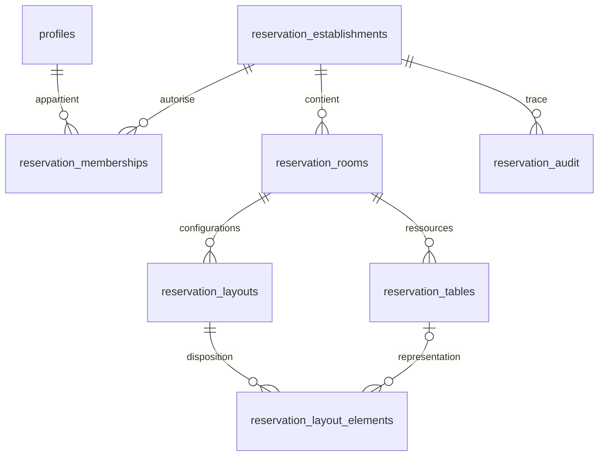

# Réservations — fondations, partie 1

Mise à jour mission 1.5 : la configuration séparée et la procédure d'installation
isolée sont préparées dans `docs/environments/README.md`. Aucun environnement
cloud n'a été installé ou validé ; l'audit ci-dessous décrit la base initiale.

## Périmètre et architecture observée

Base : `stopflow-dev`, commit `c225b020604e73b7bbe4d6fbbcf11bb457301eb6`.
Branche de travail : `feat/reservations-foundations`. Aucun push ni déploiement.

StopFlow est une application statique : `index.html`, CSS et scripts JavaScript
historiques chargés en chaîne. Aucun React/Next/Vue, package npm, build frontal
ou bibliothèque graphique n'est installé dans le dépôt. Le seul TypeScript
historique concerne une fonction Supabase de gestion des utilisateurs.
Les thèmes multiples ne sont pas implémentés ; le module reprend les variables
CSS et composants visuels existants. Il ne rajoute aucune bibliothèque.

La navigation canonique est `stopflow-070-card-navigation.js`, complétée par des
couches de menus et de gestes historiques. Trois points d'intégration suffisent :
une entrée conditionnelle, une carte d'accueil (le menu historique est masqué sur
mobile) et une destination dans `openZone()`. Les propriétaires
tactiles des menus restent inchangés. Le nouveau module utilise des contrôles
HTML natifs et une délégation click/submit/change limitée à sa propre page.
Il ne reconstruit pas ses formulaires à chaque frappe.
Les rafraîchissements des menus conservent les boutons inchangés et leur focus.
Pour Réservations, la navigation signale aussi la page ouverte au mécanisme historique de
mémorisation, pour éviter qu'une restauration tardive rejoue un ancien écran.
La page reconnaît localement le clic natif de compatibilité après le `.click()`
synthétique du propriétaire tactile historique, même si son bouton a été
reconstruit. Aucun listener tactile global n'est ajouté ou modifié.

Supabase Auth fournit l'identité ; `public.profiles.id/actif` demeure le contrat
de profil. Les droits historiques sont par département, sans établissement.
`app_settings.establishment` est un nom global, pas une identité de tenant.
`future-online/supabase/schema-propose.sql` décrit un schéma non appliqué : il
ne doit pas être pris pour le schéma opérationnel. Aucun module de salles ou
de plans n'existe dans le code actif avant cette mission.

## Modèle et sécurité



- Établissements et appartenances explicites, sans copie automatique des profils
  existants. Un administrateur global StopFlow n'accède pas automatiquement à
  tous les établissements. Le module ne transforme pas les anciens modules en
  applications multi-établissements.
- Quatre droits par appartenance : lecture, gestion des salles, gestion des
  tables, administration des configurations. Les droits de gestion nécessitent
  la lecture. Les anciens catalogues de permissions départementales ne sont
  pas modifiés, car leur scope ne peut pas exprimer ce tenant.
- Salles : nom, description, ordre, archive, version et auteurs/horodatages.
- Tables physiques : UUID immuable, libellé alphanumérique, capacité entière
  1–1000, forme ronde/carrée/rectangulaire et archive. Unicité insensible à la
  casse et aux espaces périphériques, par salle, pour les tables actives.
  Un libellé d'une table archivée peut être réutilisé avec une nouvelle identité.
- Une configuration initiale est créée transactionnellement avec chaque salle.
  Le modèle accepte plusieurs configurations mais une seule active par salle.
  Il n'existe pas encore d'interface de changement de configuration.
- Les éléments graphiques ont leur propre UUID, une référence facultative vers
  une table, x/y, dimensions, rotation, superposition, propriétés et version.
  x/y NULL signifie « non positionné ». Les types architecturaux réservés sont
  mur, porte, fenêtre, bar, escalier, plante et texte. Ils n'ont pas de capacité
  et ne peuvent pas référencer une table physique.
- Propriétés JSON limitées à `fill`, `stroke`, `label` : couleurs hexadécimales
  à six caractères, texte limité à 120 caractères. Aucun HTML, URL, style libre
  ou champ `capacity` n'est admis comme propriété graphique.
- Les FK composites imposent le même établissement et la même salle aux tables,
  configurations et éléments. Les suppressions de ressources référencées sont
  bloquées ; l'interface archive, sans cascade destructrice.
- La RLS est activée sur les sept relations. Aucun DML direct n'est accordé à
  `authenticated`. Les RPC d'écriture SECURITY DEFINER vérifient explicitement
  l'appartenance, le profil actif et le droit correspondant ; `search_path` vide.
  Les fonctions publiques ne sont pas exécutables par `anon`/PUBLIC.
- Les RPC verrouillent les ressources puis vérifient `p_expected_version`.
  Une version obsolète produit `40001`, sans écrasement. Les versions, dates et
  auteurs sont gérés en base. Un changement de table incrémente aussi la version
  de son plan, sans créer une deuxième ressource physique ni déplacer la table.
- Un audit append-only pour les clients trace INSERT/UPDATE des salles, tables,
  configurations et éléments avec valeurs avant/après. Les opérations manuelles
  de provisioning restent des opérations d'administration hors interface.

## Fonctionnalités réellement fournies

Entrée « Réservations » dans les menus existants, page « Réservations — Plan de
salle », sélection d'établissement et de salle, état vide, création/modification
et archivage/réactivation des salles et tables, capacité théorique et propriétés
des tables. Les formes sont distinctes et les textes échappés avec `escapeHTML()`.
Les formulaires gardent leur saisie sur erreur réseau, refus ou conflit de version.
Un succès n'est annoncé qu'après confirmation serveur et relecture réussie.
Si le serveur a accepté l'écriture mais que sa relecture échoue, cela est indiqué
explicitement et une actualisation est demandée avant toute nouvelle tentative.

Les tables non positionnées sont affichées sur une grille explicitement
provisoire, qui n'est jamais écrite comme le plan réel. Les coordonnées déjà
persistées peuvent être consultées. Il n'y a ni glisser-déposer, ni sélection
graphique multiple, ni nouvel éditeur, ni réservations, clients, événements,
assemblages ou calcul de disponibilité.

## Installation — uniquement après vérification d'isolation

La migration est `supabase/migrations/20261017120000_stopflow_reservations_foundation.sql`.
Elle est transactionnelle et ne contient aucune donnée de démarrage. Elle exige
les contrats existants `public.profiles(id uuid, actif boolean)`, `auth.uid()`,
le schéma `private`, et les rôles Supabase `anon/authenticated/service_role`.
Elle doit être appliquée une seule fois par le gestionnaire de migrations.
Une réapplication brute échoue sur les objets déjà créés ; ne pas supprimer des
objets pour contourner cet échec. Aucune migration distante n'a été appliquée.

Avant toute installation distante : examiner le schéma réellement déployé,
confirmer le projet Supabase isolé, ses sauvegardes et sa version PostgreSQL,
puis obtenir l'autorisation d'application. Le code historique utilise une URL
Supabase partagée par développement et production : une branche Git ou une URL
Preview ne prouve pas l'isolation des données. Aucune Preview n'a été créée.

Le provisioning initial est une opération d'administration à effectuer dans
la base isolée vérifiée. Exemple psql paramétré, **pas exécuté sur Supabase** :

```sql
-- L'opérateur fournit establishment_name et profile_id, après vérification.
begin;
insert into public.reservation_establishments(name,created_by)
values (:'establishment_name', :'profile_id'::uuid)
returning id as establishment_id \gset
insert into public.reservation_memberships
  (establishment_id,profile_id,can_view,can_manage_rooms,can_manage_tables,can_manage_layouts,created_by)
values (:'establishment_id'::uuid,:'profile_id'::uuid,true,true,true,true,:'profile_id'::uuid);
commit;
```

Pour les autres profils, accorder seulement les droits nécessaires sur les
établissements autorisés. Ne jamais dériver une appartenance depuis le nom de
l'établissement, une adresse e-mail ou le rôle global Admin. Le mode local
historique n'ouvre aucun accès au module et ne simule pas sa persistance.

## Vérification reproductible

Prérequis : Docker, Node.js, Playwright, Chromium (`/usr/bin/chromium`) et
`pdftotext` pour les tests historiques. Les nouveaux tests démarrent leur propre
PostgreSQL 16 éphémère avec `--network none`, sans port publié ni volume existant.
L'image est épinglée au digest dans `tests/helpers/reservations-db.cjs`.
Les conteneurs créés sont retirés en fin de test. Aucune URL/token cloud n'est lu.

```sh
node tests/reservations-postgres.cjs
node tests/reservations-browser.cjs
node tests/reservations-navigation.cjs
npm exec --yes --cache /tmp/stopflow-npm-cache --package typescript@5.9.3 -- tsc --allowJs --checkJs --noEmit --target ES2022 --lib ES2022,DOM tests/reservations-globals.d.ts stopflow-091-reservations.js
node tests/order-html-security.cjs
node tests/article-html-security.cjs
node tests/mobile-note-input.cjs
node tests/ios-note-focus.cjs
node tests/temperature-round-safety.cjs
```

Le contrat Auth/profiles initial du conteneur est une fixture minimale ; la
nouvelle migration est exécutée intégralement. La RLS, les contraintes et les
RPC sont du vrai PostgreSQL. Le navigateur utilise un pont de test vers ces RPC
avec le rôle `authenticated` et un UID fixé par scénario. Ce pont n'est pas un
serveur d'application et ne remplace pas la validation JWT de Supabase en production.
Seules les lectures des anciens modules sont des fixtures dans cette suite.
Les salles et tables sont réellement sauvegardées/rechargées dans PostgreSQL,
y compris après rechargement de la page. Ce n'est pas une simulation localStorage.

Le dépôt n'a pas de build frontal existant. Le nouveau JS fait l'objet d'un
contrôle TypeScript `checkJs/noEmit` avec un contrat de globals historique limité
(`data` RPC reste JSON dynamique, validé en base), en plus des contrôles de syntaxe.
Les résultats effectifs et les limites sont consignés dans `VALIDATION.md`.
Le diagnostic et la correction de navigation sont détaillés dans `NAVIGATION.md`.

## Passage à la partie 2

Réutiliser les UUID de tables et les relations salle/configuration/élément.
Ajouter des RPC d'édition graphique sous `layouts.manage`, avec version attendue,
validation des dimensions par rapport au canevas, sauvegarde atomique de tous
les éléments et snapshot immuable complet avant publication d'une version.
L'audit actuel trace les changements mais n'est pas un snapshot complet du plan.
Ne pas dupliquer les tables physiques lorsqu'une configuration change.

Le déplacement tactile devra rester local au futur canevas, avec Pointer Events,
capture de pointeur, distinction déplacement/défilement, annulation, zoom et
alternative clavier. Aucun de ces gestes n'est implémenté dans cette partie.
Les objets architecturaux restent non réservables. La migration future du moteur
de réservation devra référencer les ressources physiques et des snapshots de plan,
pas leurs numéros ou positions, et traiter conflits horaires, regroupements,
privatisation, neutralisation et capacités côté serveur. Aucun faux moteur n'est fourni.

Les risques restant à maîtriser sont l'intégration réelle Auth/PostgREST,
l'attribution opérationnelle des appartenances, la visibilité de la nouvelle entrée
dans les environnements autorisés, les conflits d'édition et l'ergonomie sur
iPhone réel. Les anciens modules restent globaux/par département : une future
extension multi-établissements de tout StopFlow demandera une migration distincte.
